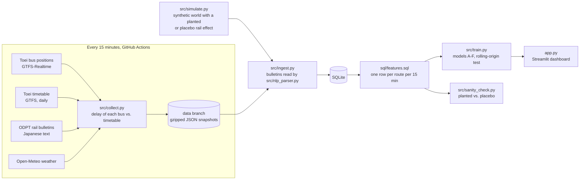
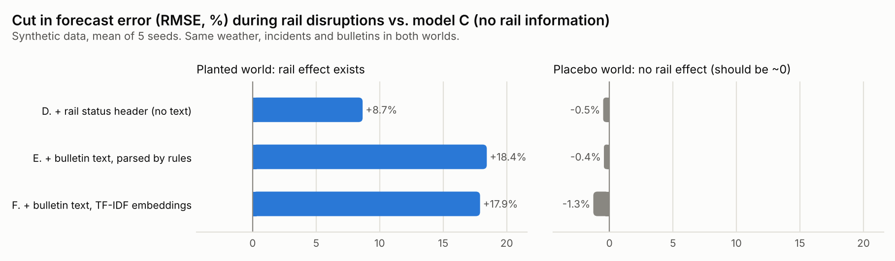
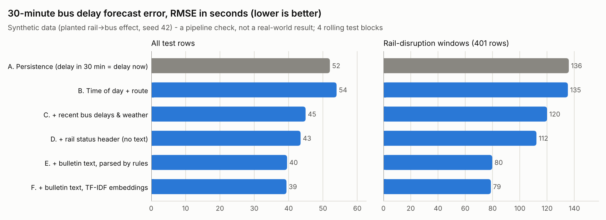
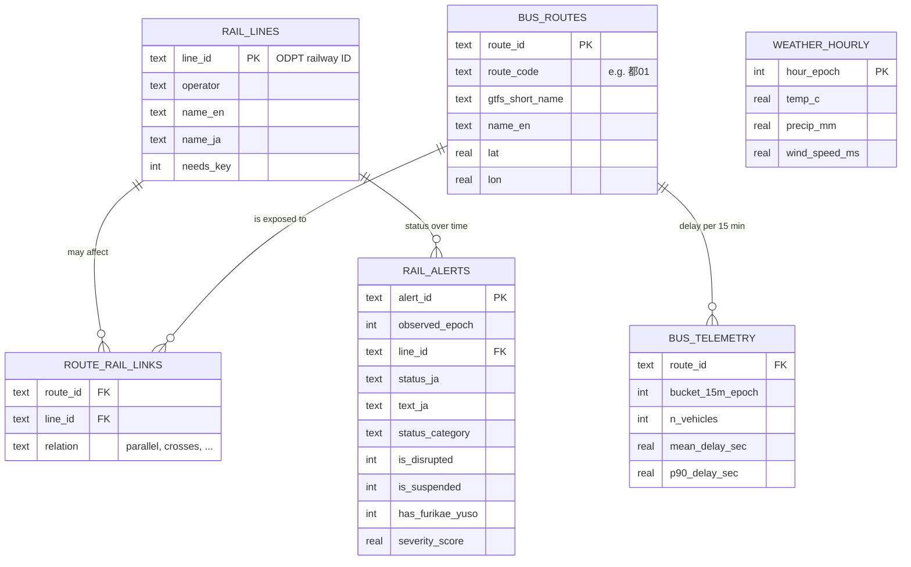

# Tokyo rail-to-bus spillover

**Question:** when a Tokyo rail line is disrupted, do nearby Toei buses actually run later, and do
the rail operators' Japanese service bulletins help forecast by how much?

When a line stops, operators often announce **振替輸送** (*furikae yusō*): passengers may use their
tickets on other lines and on buses. Stranded riders pile onto parallel bus routes, boarding takes
longer, and delays build. This project collects real-time Tokyo data to test whether that spillover
is measurable, and builds a forecasting pipeline that reads the bulletins.

## Status (18 Nov 2026)

| Part | Status |
|---|---|
| Live collector: Toei bus positions with a delay estimate per bus, ODPT rail bulletins, weather | ✅ Working; runs every 15 minutes in GitHub Actions |
| Pipeline: SQLite → SQL features → forecasting models → dashboard | ✅ Working and tested |
| Validation on synthetic data with a planted effect and a placebo | ✅ Done, see below |
| Parser accuracy on hand-labelled **real** bulletins | ⏳ Labelling in progress |
| Results on **real** data | ⏳ Collecting; analysis after 3-4 weeks |

**No real-world result is claimed yet.** Every model number below comes from synthetic data and only
shows that the pipeline behaves correctly.

## How it works



- **Bus delays from positions.** Toei publishes where each bus is and which stop it is heading to,
  not how late it is. `src/collect.py` matches each bus to its trip in Toei's timetable and measures
  the delay against the midpoint of the scheduled times of the stop it just left and the stop it is
  approaching (accurate to roughly ±1 minute).
- **Reading the bulletins.** `src/nlp_parser.py` is a transparent rule-based reader for Japanese
  bulletins: is the line disrupted, suspended, resuming, is 振替輸送 in effect, and why. It handles
  past-tense notices (「見合わせていましたが、…再開しました」), negations (「振替輸送は実施しておりません」) and
  full-width digits, all of which appear in real ODPT text.
- **Features in SQL.** `sql/features.sql` builds one row per bus route per 15 minutes with CTEs and
  window functions: a time-based rolling hour (`RANGE`, not `ROWS`), lags and the 30-minute-ahead
  target that check timestamps so gaps can't shift them, the route's linked rail lines' bulletins
  from the past hour, and the most severe recent cause via `ROW_NUMBER()`.
- **Models.** Six forecasts of the delay 30 minutes ahead, each adding one information source:
  A persistence (no model), B time of day + route, C + recent bus delays & weather, D + rail status
  header, E + bulletin text read by the parser, F + TF-IDF text embeddings. Gradient-boosted trees
  (XGBoost) predict the *change* from the current delay.

Design choices and their reasons are in [docs/DESIGN_DECISIONS.md](docs/DESIGN_DECISIONS.md).

## Validation on synthetic data

`src/simulate.py` generates rail incidents, Japanese bulletins about them, and bus delays. How much
an incident delays buses depends on hidden attributes (its phase, 振替輸送, a random size), never on
the bulletin text or the parser, so the pipeline has to recover the effect by reading the text.
Every seed is simulated twice: with the effect **planted**, and as a **placebo** with it switched off
(same weather, incidents, bulletins and bus noise).



Across 5 seeds, in rail-disruption windows, compared with model C (no rail information):

- **Placebo:** every model stays within ±2.6% in every seed. Rail features don't "help" when there
  is nothing to find, so no future information is leaking into the features.
- **Planted:** reading the bulletin text (E) cuts forecast error by 18.4% on average and helps in
  every seed, but by anywhere from 0.2% to 34%. The weakest seed's first two weeks contained only
  three suspensions to learn from, which is a preview of what a few weeks of real data may look like.
- The TF-IDF embeddings (F) add nothing beyond the rule-based parser (E).

One run with the default seed (`python -m src.train`):



| Model (seed 42, 4 rolling test blocks) | RMSE, all rows | RMSE, rail-disruption windows |
|---|---:|---:|
| A. Persistence: delay in 30 min = delay now | 52.0 s | 135.9 s |
| B. Time of day + route | 54.0 s | 135.2 s |
| C. + recent bus delays & weather | 44.9 s | 120.0 s |
| D. + rail status header (no text) | 43.5 s | 112.2 s |
| E. + bulletin text, parsed by rules | 39.6 s | 79.8 s |
| F. + bulletin text, TF-IDF embeddings | 39.4 s | 78.8 s |

Seed 42 happens to be one of the favourable seeds; use the 5-seed numbers above as the summary.

## Real data: first checks

In the first snapshots (18 Nov 2026, about 10:15-10:40 JST), every bus in Toei's live feed (593 in one
snapshot) matched the published timetable by trip, route and stop, and the median estimated delay was
about 2.5 minutes. Toei's keyless rail feed covers its six lines; its normal-service message is
「現在、１５分以上の遅延はありません。」("no delays of 15 minutes or more"), which a naive keyword
parser misreads as a delay. With an ODPT key (24 Nov 2026) the rail feed adds Tokyo Metro's lines and
a few smaller operators, but no JR East or Tokyu lines, so the project links bus routes only to Toei
and Tokyo Metro lines. These are checks that the data supports the plan, not results.

## Quickstart

```bash
python -m venv .venv
source .venv/bin/activate        # Windows: .venv\Scripts\activate
pip install -r requirements.txt

python -m src.ingest simulate    # 28 days of synthetic data (fixed seed: same numbers every run)
python -m src.train              # models A-F with rolling-origin evaluation; charts in artifacts/
python -m src.sanity_check       # planted vs. placebo over 5 seeds (about a minute)
pytest                           # test suite
streamlit run app.py             # dashboard
```

## Collecting real data

The workflow in `.github/workflows/collect.yml` runs `src/collect.py` every 15 minutes and commits each
snapshot to a `data` branch, which it creates on the first run. It needs no secrets for Toei data. To
also collect Tokyo Metro's lines, add a free key from [developer.odpt.org](https://developer.odpt.org/)
as a repository secret named `ODPT_API_KEY`.

GitHub's built-in scheduler is unreliable for frequent jobs: on this repository it ran the 15-minute
schedule only about 3-4 times a day. For a steady 15-minute rhythm, have an outside scheduler (for
example cron-job.org) call the workflow's `workflow_dispatch` endpoint, authenticated with a
fine-grained token that has only the Actions permission on this repository.

To analyse what has been collected so far:

```bash
git clone --branch data --single-branch https://github.com/<you>/<repo>.git ../tokyo-transit-data
python -m src.ingest snapshots --raw-dir ../tokyo-transit-data/raw
python -m src.train
```

To measure the parser on real bulletins, run `python -m src.parser_eval export`, fill in the `label_*`
columns of `data/labels/bulletins.csv`, then run `python -m src.parser_eval score`.

## Database



`metadata` records whether the data is simulated or collected; the charts and dashboard label
themselves from it.

## Limitations

- No result on real data yet; the synthetic results depend on assumed incident rates and effect sizes.
- Bus delay is estimated from 15-minute position snapshots (about ±1 minute per bus), not measured at stops.
- Which rail lines can affect which bus routes is a hypothesis read off the routes' stop lists
  (`ROUTE_RAIL_LINKS` in `src/config.py`); the real-data analysis is what tests it.
- Without an ODPT key only Toei's six rail lines are collected. ODPT's feed has no JR East or Tokyu
  bulletins even with a key, so JR and private-railway disruptions are not covered. The loader warns
  about any linked line it never sees.
- GitHub can delay or skip scheduled runs, so the collected data has gaps. The SQL handles them, but
  they reduce the usable data.
- The parser is keyword rules. Its accuracy on real bulletins is unknown until the labels are done.

## Data sources

- Public Transportation Open Data Center (ODPT), [odpt.org](https://www.odpt.org/): Toei bus GTFS and
  GTFS-Realtime, and rail train information. Toei data is from the Bureau of Transportation, Tokyo
  Metropolitan Government (東京都交通局). Check each dataset's licence on ODPT before republishing raw data.
- Weather: [Open-Meteo](https://open-meteo.com/) (CC BY 4.0).

## Project layout

```
app.py                     Streamlit dashboard
src/config.py              paths, data-source URLs, routes, rail lines and their links
src/collect.py             one live snapshot (run by GitHub Actions)
src/simulate.py            synthetic world with a planted or placebo effect
src/ingest.py              simulation or snapshots -> SQLite
src/nlp_parser.py          Japanese bulletin rules + TF-IDF embedder
src/train.py               models A-F, rolling-origin evaluation, charts
src/sanity_check.py        planted vs. placebo over several seeds
src/parser_eval.py         export bulletins for labelling; score the parser
src/charts.py              shared chart style
sql/schema.sql             tables
sql/features.sql           feature engineering (CTEs, window functions)
tests/                     parser, simulator, no-lookahead, collector and end-to-end tests
docs/MODEL_CARD.md         model card
docs/DESIGN_DECISIONS.md   why things are done the way they are
```
