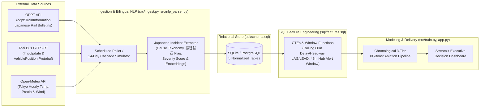
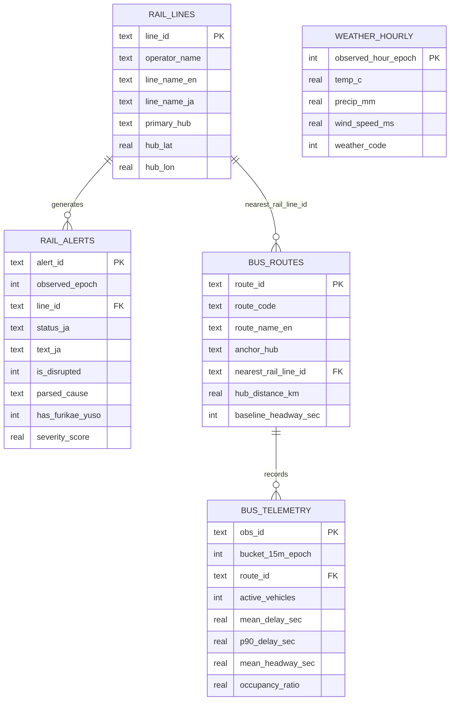

# Tokyo Multimodal Transit Disruption & Cascade Predictor

**Real-Time Cross-Modal Delay Forecasting: Fusing ODPT Japanese Rail Bulletins & Toei Bus GTFS-Realtime Telemetry**

## Overview
While Tokyo's rail network maintains high baseline punctuality, acute service disruptions (*運転見合わせ* suspensions, *人身事故* track incidents, *車両点検* rolling-stock faults, and *強風* severe-wind restrictions) trigger immediate passenger spillover onto surface bus corridors—especially when operators activate **振替輸送** (*furikae yuso*, alternative transit transfer acceptance).

This system ingests structured bus telemetry (Toei Bus GTFS-Realtime), hourly meteorological observations (Open-Meteo Tokyo), and unstructured Japanese railway operational bulletins (Public Transportation Open Data Center / ODPT `odpt:TrainInformation`) into a normalized relational database, engineers lag-safe rolling features in SQL, and forecasts **30-minute downstream bus corridor delays and surge alerts** using gradient-boosted trees and bilingual NLP embeddings.

## System Architecture



## Relational Database Schema (ERD)



## Quickstart

```bash
python -m venv .venv
source .venv/bin/activate   # Windows: .venv\Scripts\activate
pip install -r requirements.txt

# 1. Populate local SQLite database with 14 days of multimodal Tokyo transit history
python -m src.ingest --mode simulate --days 14

# 2. Run SQL feature engineering + chronological 3-tier ablation benchmark
python -m src.train

# 3. Run unit & integration tests
pytest -v

# 4. Launch the interactive 4-tab Streamlit dashboard
streamlit run app.py
```

## Live Data Collection (Optional)
1. Register for a free developer key at [developer.odpt.org](https://developer.odpt.org/).
2. Copy `.env.example` to `.env` and set `ODPT_API_KEY`.
3. Run `python -m src.ingest --mode live` or enable the GitHub Actions workflow in `.github/workflows/ingest.yml`.
